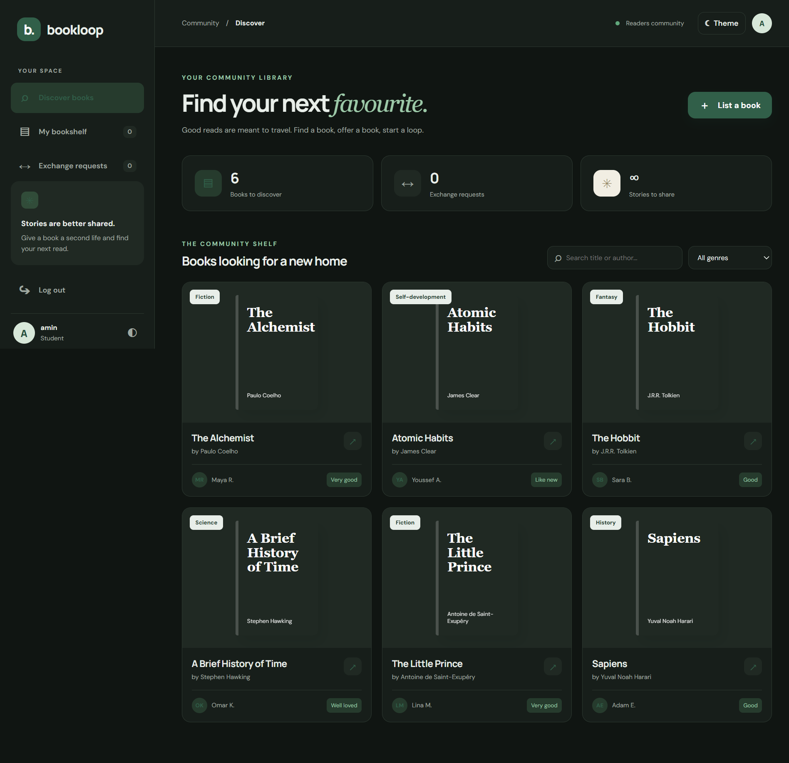
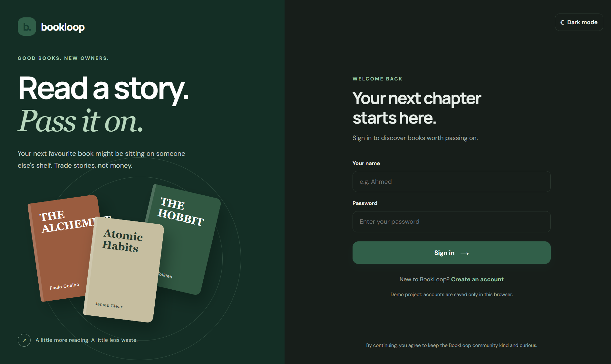
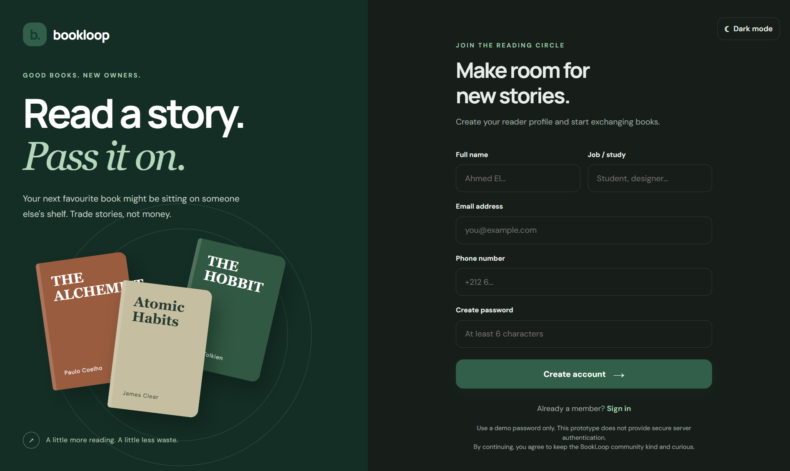
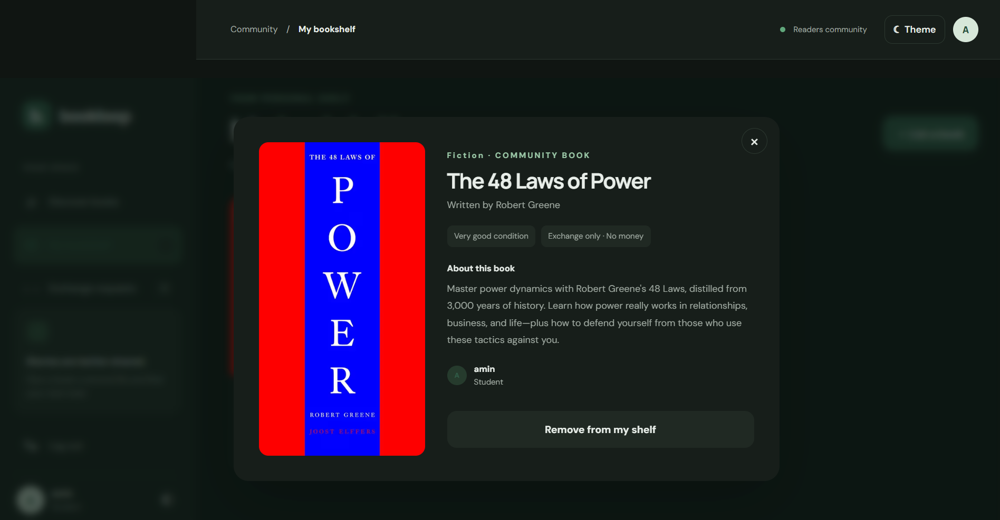
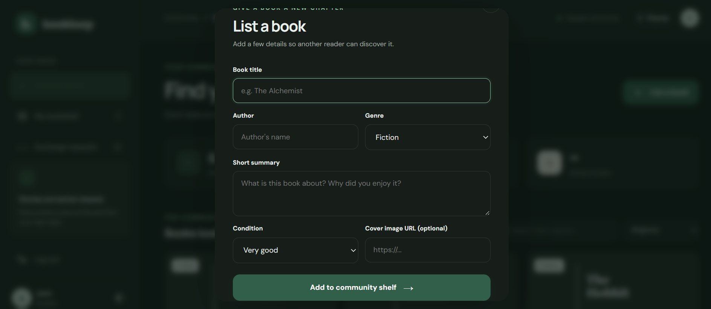
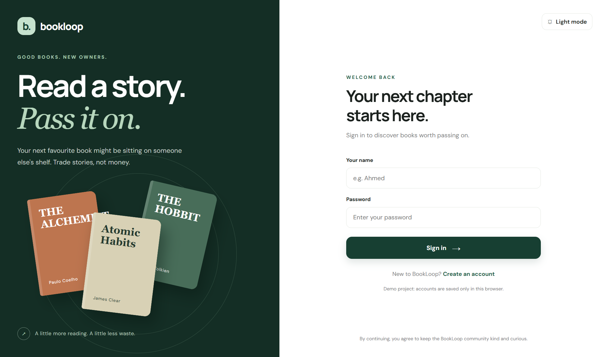

# 📚 BookLoop — Discover a Book. Exchange a Story.

**BookLoop** is a book-exchange web platform designed to connect readers and give books a new life. Instead of buying every book they want to read, users can share books they already own and exchange them with other members of the community.

The idea is simple: **your next favourite book might be waiting on someone else's bookshelf.**

---

## 📖 About the Project

BookLoop was created as a front-end development project at **MolenGeek** to practise building an interactive, responsive website using **HTML**, **CSS**, and **JavaScript**.

The platform allows readers to create an account, discover books listed by other users, publish their own books, and request exchanges.

For example, Ahmed has a book called *Book A*, while another reader has *Book B*. Ahmed can publish Book A, discover Book B, read its details, and send an exchange request by offering his own book in return.

The goal is to encourage reading, reduce unused books, and create connections between people through literature.

---

## 🎯 Project Objectives

- Build a user-friendly platform for exchanging books.
- Allow readers to discover books from other community members.
- Make it easy to publish and manage personal book listings.
- Provide a simple book-for-book exchange-request system.
- Create an attractive, responsive interface for desktop and mobile devices.
- Practise front-end development using **HTML**, **CSS**, and **JavaScript**.

---

## 🖥️ Website Preview

### Desktop Version

<!-- Replace the path below with your desktop screenshot filename. -->



*The main dashboard displaying the community bookshelf, navigation, book cards, and search filters.*

### Mobile Version

<!-- Replace the path below with your mobile screenshot filename. -->

.png)

*The responsive interface adapted for a mobile screen.*

### Login Page

<!-- Add your login-page screenshot here. -->



*The login interface where existing members can access their accounts.*

### Sign-Up Page

<!-- Add your registration-page screenshot here. -->



*The registration form for new members.*

### Book Details

<!-- Add a screenshot showing the book details modal or page. -->



*The selected book's title, author, summary, cover, condition, and owner information.*

### Add a Book

<!-- Add a screenshot of the add-book form here. -->



*The form used to publish a book on the community bookshelf.*

### Light Mode

<!-- Add a screenshot of the website in light mode here. -->



*The alternative light appearance with neutral backgrounds and green accents.*

---

## ✨ Main Features

### 1. User Authentication Interface

- Create an account using a name, job or study, email address, phone number, and password.
- Sign in using a name and password.
- Display basic profile information in the dashboard.
- Log out of the platform.

### 2. Discover Books

- Browse books listed by community members.
- Search by book title, author, summary, or owner.
- Filter books by genre.
- Open a book to explore its information.
- View book-cover images or stylised placeholder covers.

### 3. Book Details

Each book listing can display:

- Book title.
- Author's name.
- Book summary.
- Genre.
- Book condition.
- Owner information.
- Book-cover image.
- An option to request an exchange.

### 4. Add and Manage Books

Users can publish books by entering the title, author, genre, summary, condition, and an optional cover-image **URL**.

The **My Bookshelf** section allows users to view their own listings and remove books they no longer want to offer.

### 5. Book Exchange System

The exchange workflow allows a user to:

## Discover a book they would like to read.

## Open its details. ## Select one of their own listed books to offer. ## Send an exchange request to the book's owner. ## Allow the owner to accept or decline the request. ## Track the request status in the exchange section.

The concept focuses on exchanging books rather than purchasing them.

### 6. Light and Dark Modes

BookLoop includes a theme toggle so users can switch between two visual styles:

- **Dark mode:** charcoal backgrounds, deep green surfaces, and soft green highlights.
- **Light mode:** bright neutral backgrounds, grey details, and green accents.

The design aims to keep the reading experience comfortable and visually consistent.

### 7. Responsive Design

The interface adapts to different screen sizes, including desktop computers, tablets, and mobile phones.

The desktop version uses a sidebar navigation layout, while smaller screens use a more compact arrangement.

---

## 🎨 Design and Colour Palette

BookLoop uses a modern, minimalist visual identity inspired by books, libraries, and reading communities.

| Colour | Purpose |
| --- | --- |
| Deep forest green | Primary buttons and brand identity |
| Charcoal black | Dark-mode backgrounds |
| Muted grey | Secondary text and interface details |
| Light grey | Borders and neutral surfaces |
| Soft green | Highlights, labels, and selected elements |
| Off-white | Light-mode backgrounds |

The interface uses rounded cards, subtle borders, clean typography, and generous spacing to create a professional appearance.

---

## 🛠️ Technologies Used

### HTML5

Used to structure the website, forms, navigation, book cards, and modal dialogs.

### CSS3

Used for styling, layouts, responsive design, colour themes, animations, and interactive visual states.

### JavaScript

Used to manage form submissions, book listings, search and filtering, exchange requests, theme switching, and dynamic updates to the interface.

### Browser Local Storage

Used in this prototype to preserve account, book, and request data in the current browser.

### Google Fonts

The interface uses **Manrope** for prominent headings and **DM Sans** for general interface text.

---

## 📂 Project Structure

```text
bookloop-platform/
│
├── index.html
├── style.css
├── script.js
├── **README**.md
│
└── screenshots/
    ├── desktop-dashboard.png
    ├── mobile-dashboard.png
    ├── login-page.png
    ├── signup-page.png
    ├── book-details.png
    ├── add-book.png
    ├── exchange-requests.png
    └── light-mode.png
```

**File responsibilities:**

- `index.html` — website structure and interface elements.
- `style.css` — visual design, responsive layouts, and light/dark themes.
- `script.js` — application logic and user interactions.
- `screenshots/` — screenshots documenting the different website views.
- `**README**.md` — project description, documentation, and setup instructions.

---

## 🚀 How to Run the Project

## Download or clone the project.

Open the project folder in Visual Studio Code. Make sure `index.html`, `style.css`, and `script.js` are in the same folder. Install the  **Live Server** extension if necessary.  Right-click `index.html`. Select **Open with Live Server**.

The website will open in your browser, where you can create a demo account and explore the interface.

---

## ⚠️ Current Limitations

BookLoop is currently a **front-end prototype for learning purposes**.

- Accounts and data are stored locally in the browser.
- Different users on separate devices do not share the same books or requests.
- Passwords are not securely protected in this prototype.
- There is no backend server or central database.
- An accepted exchange request does not automatically arrange the physical exchange.

**Security note:** Do not use real passwords or sensitive personal information in this prototype. A production version should use a backend, a database, secure authentication, password hashing, server-side validation, and appropriate privacy protections.

---

## 🔮 Future Improvements

Potential improvements for future versions include:

- Integrating a backend and database.
- Implementing secure user authentication.
- Allowing users to edit their book listings.
- Adding location-based book discovery.
- Adding book reviews and user ratings.
- Implementing notifications for exchange requests.
- Adding a messaging system between readers.
- Tracking completed exchanges.
- Deploying the platform online.

---

## 🎓 Learning Outcomes

This project provides practical experience with:

- Structuring web pages with **HTML**.
- Styling interfaces with **CSS**.
- Creating responsive layouts.
- Handling forms and user interactions with **JavaScript**.
- Manipulating the **DOM** dynamically.
- Working with arrays, objects, functions, and events.
- Saving data using browser local storage.
- Building a complete front-end user journey.

---

## 👨‍💻 Author

Developed by **Ahmed** as a front-end development learning project at **MolenGeek**.

**Project:** BookLoop **Category:** Book Exchange Platform **Technologies:** **HTML5**, **CSS3**, **JavaScript**

---

### 🌱 BookLoop

**Read more. Waste less. Share stories.**